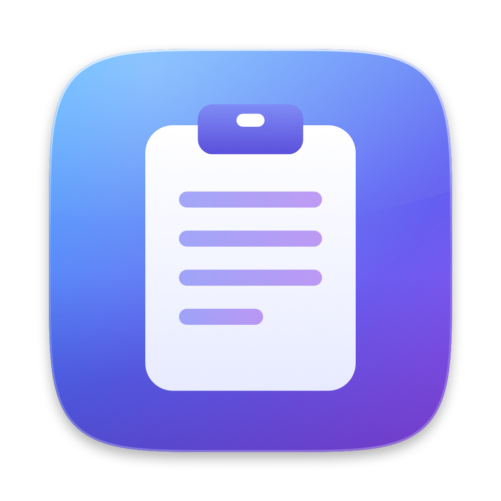
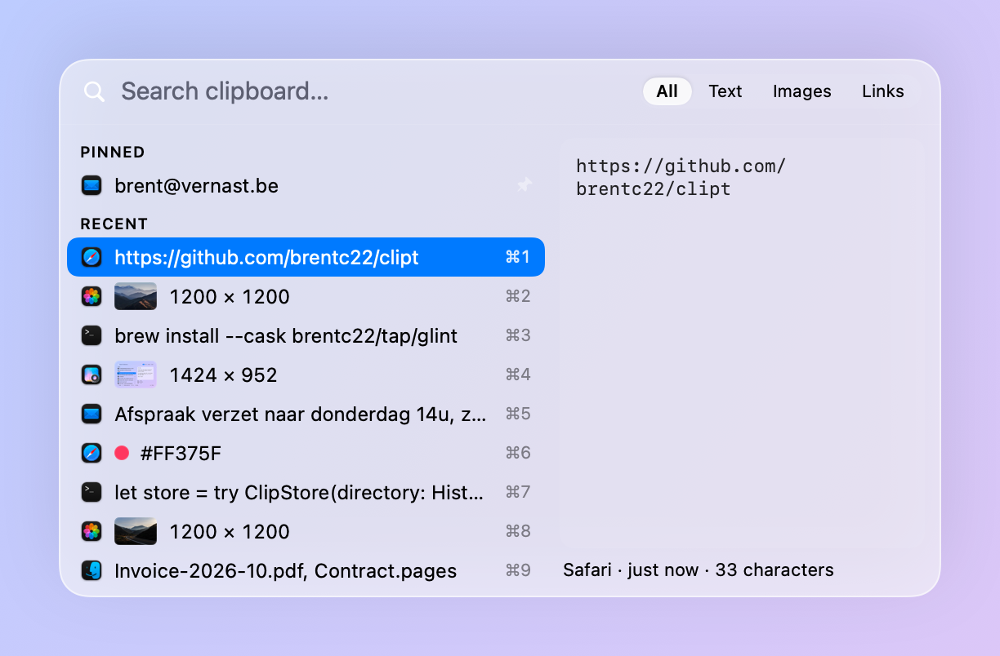

<p align="center">
  
</p>

<h1 align="center">Clipt</h1>

<p align="center">
  <b>Clipboard history for macOS, one keystroke away.</b><br>
  Press <kbd>⌘⇧C</kbd>, arrow to an item, press <kbd>↩</kbd>: it's pasted into the app you came from.
  A native Liquid Glass panel, free and open source.
</p>

<p align="center">
  <a href="https://github.com/brentc22/clipt/releases/latest"></a>
  
  
  <a href="LICENSE"></a>
</p>

<p align="center"><code>brew install --cask brentc22/tap/clipt</code></p>

<p align="center">
  
</p>

---

## Why

macOS 26's Spotlight keeps a clipboard history, but there is no shortcut straight to it:
<kbd>⌘Space</kbd>, then <kbd>⌘4</kbd>, and it doesn't paste into the app you were in. Most of
the time you want something much simpler: press a key, go down to one of the last few
items, press Return, done.

Clipt does exactly that. It has Maccy's speed (the panel is on screen within a frame of the
keypress, and memory stays flat as the history grows) with a look that belongs on macOS 26:
real Liquid Glass, spring motion that respects Reduce Motion, no subscription.

## Features

- **Instant panel.** <kbd>⌘⇧C</kbd> opens it with the newest item already selected. Change
  the shortcut in Settings if it clashes with something.
- **Paste into the app you came from.** Return pastes and closes the panel. Click a row, or
  press <kbd>⌘1</kbd>–<kbd>⌘9</kbd> for the first nine rows.
- **Keeps what you copied, as it was.** Text (with formatting; <kbd>⌥↩</kbd> pastes it
  plain), images, files, links and colors, each with the app it came from. Whatever else
  the source app put on the pasteboard is kept too, so a spreadsheet range pastes back as a
  range.
- **Search everything.** Typing filters the whole history, including text inside images
  (read on-device with Vision). Chips narrow it to Text, Images or Links.
- **Pins** stay at the top, never expire and don't count toward the limit.
- **Preview** of the selected item: full text, the image, the link, or the color.
- **Retention you choose.** Keep 200, 1,000 (default), 5,000 or unlimited items, and
  optionally drop anything older than 1, 7 or 30 days.
- **Menu bar item** with Open, Pause Capture, Clear History and Check for Updates. You can
  hide the icon and launch Clipt at login.
- **Updates itself** from GitHub Releases (see [Updates](#updates)).

## Keyboard

| Key | Action |
| --- | --- |
| <kbd>⌘⇧C</kbd> | Open or close the panel (global, remappable) |
| <kbd>↑</kbd> <kbd>↓</kbd> | Move the selection |
| <kbd>↩</kbd> | Paste the selected item |
| <kbd>⌥↩</kbd> | Paste as plain text |
| <kbd>⌘1</kbd>–<kbd>⌘9</kbd> | Paste the row showing that number |
| <kbd>⌘P</kbd> | Pin or unpin |
| <kbd>⌫</kbd> | Delete the selected item (when the search field is empty) |
| <kbd>Esc</kbd> | Clear the search, or close the panel |
| Typing | Search |

<kbd>⌘⇧C</kbd> is also the element inspector in Chrome and Safari, and "Computer" in the
Finder. A global shortcut takes it over everywhere; remap it in Settings if you need those.

## Privacy

- **Everything stays on your Mac**, in `~/Library/Application Support/Clipt`. The only
  network request Clipt makes on its own is the daily update check.
- **Passwords are never saved.** Items marked concealed, transient or auto-generated
  (`org.nspasteboard.*`, 1Password, and similar) are skipped before their content is read,
  and the ignored-apps list starts with Passwords, Keychain Access, 1Password and Bitwarden.
  Add your own apps in Settings.
- **Pause Capture** from the menu bar when you don't want something recorded.
- The panel is hidden from screenshots and screen sharing.
- Images are read with on-device OCR only to make them searchable.

## Install

```sh
brew install --cask brentc22/tap/clipt
```

Or download `Clipt.zip` from the [latest release](../../releases/latest), unzip, and move
`Clipt.app` to `/Applications`. Requires macOS 26 Tahoe or later. Universal binary.

Clipt isn't notarized yet, so macOS blocks the first launch. Open System Settings →
Privacy & Security and click **Open Anyway**, or clear the quarantine flag:

```sh
xattr -dr com.apple.quarantine /Applications/Clipt.app
```

### Permissions

Clipt asks for two things on first launch and walks you through them:

- **Accessibility** (System Settings → Privacy & Security → Accessibility), so it can
  press <kbd>⌘V</kbd> for you. Without it, Clipt still copies the item and tells you to
  press <kbd>⌘V</kbd> yourself.
- **Paste from Other Apps** (System Settings → Privacy & Security → Paste from Other
  Apps). macOS shows a one-time alert the first time Clipt reads something you copied;
  choose **Allow**. Onboarding has an **Ask macOS now** button to get that alert out of
  the way up front. Clipt only appears in the Paste from Other Apps list after that first
  alert. If the setting is "Ask" or "Don't Allow", Clipt pauses capture rather than
  raising an alert on every copy, and says so in the menu bar icon and the panel.

### Updates

Clipt checks GitHub Releases once a day. When there is a newer version it shows the release
notes with **Install and Relaunch**, **Later** and **Skip This Version**. A waiting update
also shows in the menu bar menu, and Settings → About has **Check Now** and a switch for
the daily check.

Before swapping anything in, Clipt checks that the download is `com.brentc22.Clipt`, is the
version the release promised, comes as a single `Clipt.app` in the archive, and that
macOS accepts its code signature against **the designated requirement of the copy you are
running** (same bundle id, same certificate). An
update signed by anyone else is refused. If any check fails, or `/Applications` isn't
writable, Clipt offers the download page instead.

Releases are signed with a self-signed certificate (`Clipt Self-Signed`), not ad-hoc, so
the app keeps the same identity across versions and the Accessibility permission survives
updates.

## Development

Only the Xcode Command Line Tools are needed, no full Xcode.

```sh
git clone https://github.com/brentc22/clipt.git
cd clipt
scripts/make-signing-cert.sh   # once: a stable local identity keeps Accessibility across rebuilds
make run                       # build, sign, install to /Applications, launch
make test                      # swift run CliptTests: a plain executable, XCTest needs full Xcode
make icon                      # re-render Resources/Clipt.icns from scripts/make-icon.swift
```

There is no silent ad-hoc fallback: an ad-hoc signature changes with every build and macOS
drops the Accessibility grant. `make bundle CLIPT_SIGN_IDENTITY=-` exists for CI checks only.

### Releasing

Pushing a tag like `v0.1.0` runs `.github/workflows/release.yml`: it imports the signing
identity into a temporary keychain, runs the tests, builds and signs the universal app,
checks that it is signed with the identity pinned in `Resources/designated-requirement.txt`, and publishes `Clipt.zip` with the newest
section of `CHANGELOG.md` as the notes.

The identity comes from two repository secrets:

- `CLIPT_SIGNING_P12`: the base64 of the exported `.p12`
- `CLIPT_SIGNING_PASSWORD`: its password (`clipt` for a certificate made by the script)

`scripts/make-signing-cert.sh --export <dir>` writes `<dir>/clipt-signing.p12` and prints
its base64, but only on the run that **creates** the identity. If `Clipt Self-Signed` is
already in your keychain, export it by hand: open Keychain Access → login → My
Certificates, select **Clipt Self-Signed** (the private key must be under it), File →
Export Items…, choose `.p12`, and set the password. Then
`base64 -i clipt-signing.p12 | pbcopy` and paste it into the secret. Delete the `.p12`
afterwards. The same certificate must sign every release, or installed copies will refuse
the update.

```
Sources/
  CliptCore/    storage, classification, search, panel logic, updater checks; no UI, fully tested
  Clipt/        the menu bar app: capture, panel, paste, settings, onboarding
  CliptTests/   tests (a plain executable)
```

## License

MIT, see [LICENSE](LICENSE).
